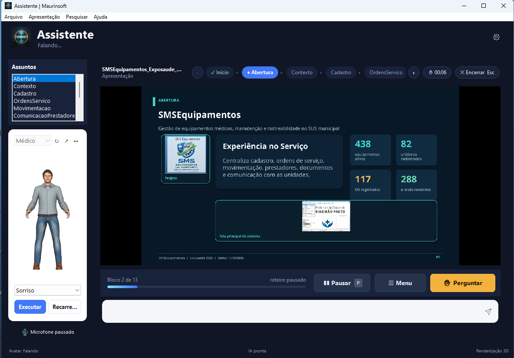

# Instalação 0.218

Execute `bin/setup_assistente_0218.exe`. A instalação é por usuário, em `%LOCALAPPDATA%\Programs\Assistente`, e atualiza a 0.217 mantendo configurações, histórico, avatares pessoais, catálogo de movimentos editado e documentos do RAG. Feche o Assistente antes de instalar.

O instalador fica no Git LFS. Se o arquivo baixado tiver poucos bytes, rode `git lfs pull` antes de executá-lo.

## Novidades

### Novo visual

- Tema escuro azul em toda a janela, também na tela inicial, antes de abrir uma apresentação.
- Ícone do Assistente no cabeçalho, na barra de título e na barra de tarefas.
- Botões coloridos: azul para a ação principal, âmbar para **Perguntar**, escuro para as demais.
- Fora da apresentação, a conversa aparece num cartão branco. Durante a apresentação, a área fica escura, como um palco.

### Modo apresentação

- **Barra de blocos** no topo, com o nome da apresentação, os blocos em sequência e o bloco atual em destaque. Os blocos já apresentados recebem ✓.
- A barra rola na horizontal pelas setas ‹ › ou pela roda do mouse. O bloco atual sempre volta para a área visível. Para abrir um bloco, use a lista de Assuntos ou o Menu.
- À direita da barra ficam o **cronômetro** da apresentação e o lembrete **Encerrar (Esc)**: a tecla Esc encerra a apresentação.
- A mídia ocupa a área central. Não há legenda: o avatar fala e a tela mostra só o slide, a imagem ou o vídeo.
- Abaixo da mídia, a **barra de progresso** mostra "Bloco N de M" e o estado do roteiro, ao lado dos botões **Pausar (P)**, **Menu** e **Perguntar**. Pausar congela a narração e vira **Retomar**. Depois de Perguntar ou Menu, o botão **Continuar** aparece para retomar o roteiro.
- A caixa de pergunta só aparece no modo de pergunta (roteiro pausado por Perguntar ou `[PERGUNTAR]`). Enquanto o roteiro corre, ela fica escondida.
- Depois da primeira pergunta, o cartão **Perguntas da plateia** ocupa a área principal no lugar da mídia, com perguntas e respostas. Ao continuar, o cartão é limpo e a mídia volta.

### Coluna da esquerda e menu Apresentação

- Lista de **Assuntos**, os blocos da apresentação, acima do avatar. Clique ou Enter abre o bloco. O bloco atual fica selecionado.
- Divisória arrastável para ajustar a largura da coluna da esquerda.
- Menu **Apresentação** com **Carregar apresentação (.pva)**, **Iniciar do começo** e **Assuntos**. Carregar abre a apresentação sem iniciá-la.

### Configurações

- As abas foram substituídas por uma lista lateral agrupada:
  - **Essencial**: Inteligência artificial, Voz (fala), Microfone e Avatar 3D.
  - **Apresentações**: Documentos (RAG).
  - **Avançado**: Câmera e Kinect, Integração externa, Jarvis residencial e Banco de dados.
- Cada seção tem um ponto de status: verde (último teste aprovado), vermelho (falhou) ou cinza (recurso desligado).
- O título e a descrição da seção ficam no topo, com o resultado do último teste.
- **Salvar** (azul) e **Cancelar** ficam no rodapé. O aviso **Alterações não salvas** aparece ao lado deles.

Os recursos da 0.217 (exportar/importar configuração e documentos do RAG) continuam iguais; veja [INSTALACAO_0217.md](INSTALACAO_0217.md). Detalhes das perguntas em [perguntas-apresentacao.md](perguntas-apresentacao.md).

## Ferramentas incluídas

Assistente, Editor de Tags/Apresentações, ferramenta PVA, prévia do Editor de Movimentos e Criador Avatar com Python isolado.

## Verificação

Os hashes de cada arquivo estão em `bin/setup_assistente_0218.manifest.json` e o resultado dos testes em `bin/setup_assistente_0218.validacao.json`. O SHA-256 do instalador é `39c8f8104c121991882cb3ac9126734c44c5c4f6c6bc2377b50573d6d721b848`.
